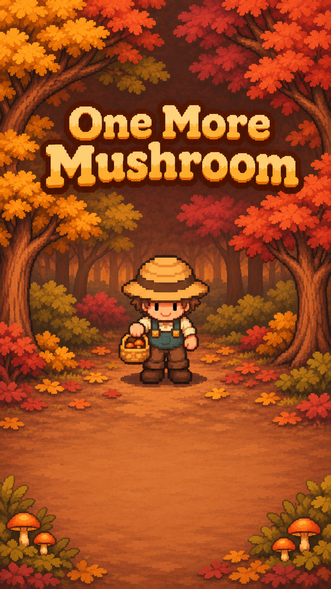
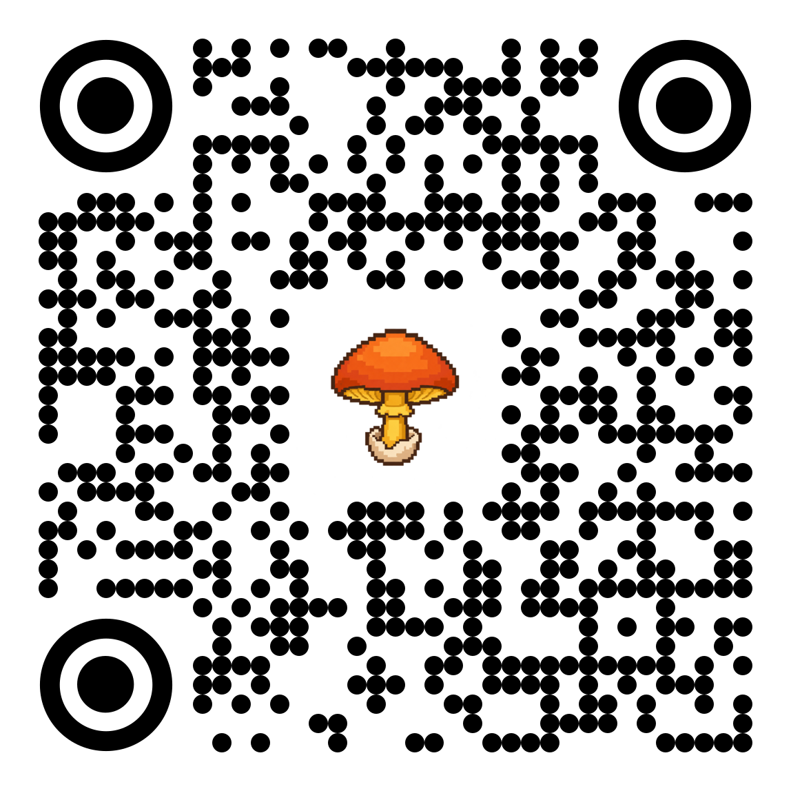

# One More Mushroom 🍄

A relaxing browser game about exploring a forest and collecting mushrooms.

Take a break, enjoy the music, and see what you can find.
There is always one more mushroom…

**[🍄 Play One More Mushroom](https://msaakmi.github.io/one-more-mushroom/)**



## How to play

Explore the forest and collect every edible mushroom on the map to win.

Easy! Or maybe not…

Some mushrooms are poisonous, and brambles can hurt you too.
You start with **five lives**. Lose them all, and the game is over!

Trees, rocks, and logs block your path, so you will need to find
your way around them.

### Collecting mushrooms

Move into contact with a mushroom and hold the collect control
until the collection is complete.

Releasing the control or moving away cancels the collection.

### Controls

| Action | PC | Mobile |
| --- | --- | --- |
| Move | Hold an arrow key | Hold an on-screen arrow |
| Collect | Hold the space bar | Hold the mushroom button |
| Cancel collection | Release the space bar | Release the mushroom button |

## Gameplay

### Collecting a mushroom

Find a mushroom, hold to collect it, and watch your collection grow.


### Taking damage

Watch out for brambles, and be careful what you pick:
poisonous mushrooms cause damage when collected.


## Your mushroom collection

Each edible mushroom type appears in your inventory after you collect
it for the first time.

The counters show **collected / total**, so you can keep track of
what is still waiting in the forest.

Discover all five edible types:

- Cep
- Ou de reig
- Rossinyol
- Rovelló
- Trompeta

Collect them all to complete the game!

## Play on mobile

Use the on-screen controls to explore and collect mushrooms.

Scan the QR code below to open the game on your phone.
You can also tap the code to play.

<a href="https://msaakmi.github.io/one-more-mushroom/">
  
</a>

## Features

- Random mushroom and obstacle placement.
- Edible and poisonous mushrooms.
- An inventory that reveals mushroom types as you discover them.
- Obstacles that block movement and brambles that cause damage.
- Animated walking, collecting, and damage states.
- Music and sound effects.
- Keyboard and touch controls.
- Start, victory, and game-over screens.

## Built with

- HTML5 and Canvas
- CSS
- Vanilla JavaScript

I built this game as a learning project to practice JavaScript classes,
Canvas rendering, sprite animation, collision detection, game loops,
and mobile controls.

## Run locally

1. Clone or download this repository.

   ```bash
   git clone https://github.com/msaakmi/one-more-mushroom.git
   cd one-more-mushroom
   ```

2. Open the project folder in your editor.
3. Serve the project folder with a local development server.
4. Open `index.html` through that server.

## Author

Created by **[msaakmi](https://github.com/msaakmi)**.
